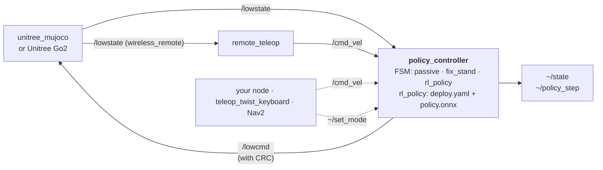

# go2_policy_runner

ROS 2 Humble (C++) runner for IsaacLab / [unitree_rl_lab](https://github.com/unitreerobotics/unitree_rl_lab)
locomotion policies on the Unitree Go2. The same nodes and the same configuration run in
[unitree_mujoco](https://github.com/unitreerobotics/unitree_mujoco) and on the real robot. Only
the DDS network interface changes between the two.

> [!WARNING]
> **This package is experimental and still being tested.** It has not been fully validated on
> real hardware. A legged robot running a learned policy can fall, damage itself or hurt people
> nearby. **Use it entirely at your own risk.** Always test in simulation first, keep a clear
> area around the robot, and be ready to cut motor power at any moment. The authors accept no
> liability for any damage or injury (see [License](#license)).

## Features

- **Sim and real behave identically.** The controller talks to the robot through plain ROS 2
  topics (`unitree_go/LowState` → `unitree_go/LowCmd`). `unitree_mujoco` publishes the same
  topics, so the node cannot tell simulation from the real robot.
- **No `unitree_sdk2` dependency.** The few robot-specific pieces (LowCmd CRC, wireless-remote
  decoding, releasing the built-in sport mode through the motion switcher) are implemented on
  top of ROS 2 topics.
- **Runs unitree_rl_lab exports directly.** It reads `exported/policy.onnx` and
  `params/deploy.yaml`. The observation and action pipeline is a port of
  `unitree_rl_lab/deploy` and gives numerically identical actions on a reference policy.
- **Standard ROS interfaces.** Velocity commands come from `/cmd_vel`
  (`geometry_msgs/Twist`), mode changes from a service, and the controller state and every
  policy step are published on topics.
- **Configurable FSM.** Modes and transitions are defined in YAML. Supported mode types are
  damping (`passive`), interpolated poses (`fix_stand`) and learned policies (`rl_policy`).
  Transitions can be triggered from the Unitree remote, using the same expression syntax as
  `unitree_rl_lab/deploy`.
- **Safety layer.** The controller switches to damping when `lowstate` stops arriving, when
  the base tilts too far, or when a mode throws an error. It also enforces hard joint
  position-target limits, refuses to start if another process is publishing `lowcmd`, and puts
  the motors into damping on shutdown.

## Packages

| Package | Contents |
|---|---|
| `go2_policy_runner_interfaces` | `ControllerState.msg`, `PolicyStep.msg`, `SetMode.srv` |
| `go2_policy_runner` | Core library (policy environment, ONNX Runtime, FSM, remote decoder), `policy_controller` and `remote_teleop` nodes, launch file, Go2 config |

## Architecture



### `policy_controller`

| Interface | Type | Description |
|---|---|---|
| `lowstate` (sub) | `unitree_go/LowState` | Robot state, including the wireless remote |
| `cmd_vel` (sub) | `geometry_msgs/Twist` | Base velocity command for `rl_policy` modes (`linear.x`, `linear.y`, `angular.z`). Falls back to zero after `cmd_vel_timeout` |
| `lowcmd` (pub) | `unitree_go/LowCmd` | Motor commands, published at `control_rate` |
| `~/state` (pub, latched) | `go2_policy_runner_interfaces/ControllerState` | Active mode, allowed transitions, health and loop rates |
| `~/policy_step` (pub) | `go2_policy_runner_interfaces/PolicyStep` | Observations, raw actions, joint targets and inference time for every policy step |
| `~/set_mode` (srv) | `go2_policy_runner_interfaces/SetMode` | Request an FSM transition |

### `remote_teleop`

Converts the Unitree remote sticks into `/cmd_vel`. Left stick: forward and sideways. Right
stick: yaw. In `unitree_mujoco`, a gamepad emulates the remote when `use_joystick: 1` is set.
Disable this node (`teleop:=false`) if something else publishes `/cmd_vel`.

### Startup sequence

1. Wait for `lowstate`.
2. If a motion switcher service is present on the network (real robot), query it and release
   the active sport mode. If no service is present (simulation), skip this step.
3. Listen to `lowcmd` for `lowcmd_check_duration` seconds. If any other process is publishing,
   abort.
4. Start publishing `lowcmd` in the `initial` mode (`passive` by default).

## FSM

Default Go2 configuration (`config/go2.yaml`). Remote key combinations follow
`unitree_rl_lab/deploy`:

| From | To | Remote | Notes |
|---|---|---|---|
| any | `passive` | `LT + B` | Damping only. Also reachable through the service from any mode |
| `passive` | `stand` | `LT + A` | Fold the legs, then stand up |
| `stand` | `walk` | `start` | Run the RL policy |
| `stand`, `walk` | `sit` | `LT + down` | Lie down |
| `sit`, `walk` | `stand` | `LT + A` | |

Each control cycle picks at most one transition. The first applicable source wins, in this
order:

1. **Fault.** `lowstate` older than `lowstate_timeout`.
2. **Mode safety check.** Base tilt above `max_tilt` in `rl_policy`.
3. **Service request.**
4. **Remote expression.**

While a fault persists, the FSM cannot leave the fallback mode. If a mode throws an exception,
for example an ONNX Runtime error, the FSM switches to the fallback mode. The `~/set_mode`
service only allows transitions defined for the active mode, plus the fallback mode. A
transition with an empty expression (`""`) can only be triggered by the service.

Remote expression syntax: `"LT + A.on_pressed"`, `"start.on_pressed"`, `"LT(2s) + down"`,
`"LT(0.5s)"`, `"X | Y"`, `"!A"`, `"(A + B) | X"`.
Keys: `LT RT LB RB A B X Y up down left right start back F1 F2 lx ly rx ry`, case-insensitive.
Invalid expressions are rejected at startup.

## Requirements

- Ubuntu 22.04, ROS 2 Humble
- `rmw_cyclonedds_cpp`. Unitree robots use CycloneDDS, and the `unitree_go` messages are only
  wire-compatible through it.
- `unitree_go` and `unitree_api` message packages from
  [unitree_ros2](https://github.com/unitreerobotics/unitree_ros2) (`cyclonedds_ws/src/unitree`)
- ONNX Runtime C/C++ (CPU). The x86_64 and aarch64 (Jetson) builds are both supported.
- Eigen 3, yaml-cpp

## Build

```bash
sudo apt install ros-humble-rmw-cyclonedds-cpp libyaml-cpp-dev libeigen3-dev

mkdir -p ~/ros2_ws/src && cd ~/ros2_ws/src
git clone https://github.com/pavelmino44/go2_policy_runner.git
git clone https://github.com/unitreerobotics/unitree_ros2.git
touch unitree_ros2/example/COLCON_IGNORE    # only the message packages are needed

# ONNX Runtime: downloads the release matching this machine's architecture into thirdparty/
./go2_policy_runner/go2_policy_runner/scripts/fetch_onnxruntime.sh
# or use an existing installation: --cmake-args -DONNXRUNTIME_ROOT=/path/to/onnxruntime

cd ~/ros2_ws
source /opt/ros/humble/setup.bash
colcon build --cmake-args -DCMAKE_BUILD_TYPE=Release
source install/setup.bash
```

Tests (no robot or simulator needed):

```bash
colcon test --packages-select go2_policy_runner && colcon test-result --verbose
```

## Usage

The launch file configures DDS for all the nodes it starts:
`RMW_IMPLEMENTATION=rmw_cyclonedds_cpp`, `ROS_DOMAIN_ID` and `CYCLONEDDS_URI`.

| Argument | Default | Description |
|---|---|---|
| `network_interface` | `lo` | Interface the robot or simulator is reachable on (`lo`, `enp3s0`, …). Set `auto` to let DDS choose |
| `domain_id` | `0` | DDS domain. Unitree robots use 0 |
| `policy_dir` | | Policy for `rl_policy` modes that don't set their own `policy_dir` |
| `config` | `config/go2.yaml` | Parameter file |
| `teleop` | `true` | Start `remote_teleop` |
| `log_level` | `info` | |

`policy_dir` accepts:
- a run directory containing `exported/policy.onnx` and `params/deploy.yaml`;
- an experiment directory such as `logs/rsl_rl/unitree_go2_velocity`, in which case the latest
  run is selected;
- a path relative to the package `policies/` folder;
- a `package://` URI.

### Simulation (unitree_mujoco)

In `unitree_mujoco/simulate/config.yaml`:

```yaml
robot: "go2"
domain_id: 0        # same as the real robot, so only the interface differs
interface: "lo"
use_joystick: 1     # optional: a gamepad emulates the Unitree remote
```

```bash
./unitree_mujoco
ros2 launch go2_policy_runner policy_runner.launch.py network_interface:=lo \
    policy_dir:=/path/to/unitree_rl_lab/logs/rsl_rl/unitree_go2_velocity
```

To check the wiring without a trained policy, use `policy_dir:=go2_zero_smoke_test`. This
policy always outputs zero actions, so the robot just holds its default pose. **Simulation
only.**

### Real robot

> [!CAUTION]
> Releasing the sport mode disables the robot's built-in controller. **Put the robot in the
> lying position before starting.** A standing robot will collapse. Keep the remote in hand:
> `LT + B` switches to damping.

Connect the robot over Ethernet and give the PC an address in 192.168.123.0/24. Then run:

```bash
ros2 launch go2_policy_runner policy_runner.launch.py network_interface:=enp3s0 \
    policy_dir:=/path/to/unitree_rl_lab/logs/rsl_rl/unitree_go2_velocity
```

### Commands

```bash
# Other terminals need the same DDS settings
source install/go2_policy_runner/share/go2_policy_runner/scripts/dds_env.sh lo   # or enp3s0

ros2 topic echo /policy_controller/state
ros2 service call /policy_controller/set_mode go2_policy_runner_interfaces/srv/SetMode "{mode: stand}"
ros2 service call /policy_controller/set_mode go2_policy_runner_interfaces/srv/SetMode "{mode: walk}"
ros2 topic pub -r 20 /cmd_vel geometry_msgs/msg/Twist "{linear: {x: 0.5}}"    # with teleop:=false
ros2 bag record /policy_controller/policy_step /lowstate /lowcmd /cmd_vel
```

## Configuration

Parameters live in `config/go2.yaml`. Every per-motor array uses the SDK motor order:
FR, FL, RR, RL legs, each with hip, thigh, calf. An array with a single value is applied to all
motors.

| Parameter | Default | Description |
|---|---|---|
| `num_motors` | 12 | Number of motors controlled |
| `control_rate` | 500 | `lowcmd` rate in Hz. `step_dt × control_rate` must be an integer |
| `lowstate_timeout` | 0.1 | Seconds without `lowstate` before the controller falls back to `passive` |
| `cmd_vel_timeout` | 0.5 | Seconds without `cmd_vel` before the command falls back to zero |
| `motion_switcher.mode` | `auto` | `auto`: release the sport mode if the service exists. `release`: the service is required. `skip`: never touch it |
| `lowcmd_check_duration` | 0.5 | Seconds to listen for other `lowcmd` publishers before starting. `0` disables the check |
| `joint_limits.lower` / `.upper` | from `go2.xml` | Hard limits on the position targets of every mode |
| `poses.<name>` | `lie`, `stand` | Key poses shared by `fix_stand` modes |
| `fsm.modes`, `fsm.initial`, `fsm.fallback` | | Enabled modes, the starting mode and the fallback mode. The fallback mode must have type `passive` |
| `fsm.<mode>.transitions.<target>` | | Remote expression, or `""` for service-only transitions |

Mode types and their parameters:

| Type | Parameters | Behaviour |
|---|---|---|
| `passive` | `kd` | Damping only (`kp = 0`). Used as the fallback mode |
| `fix_stand` | `kp`, `kd`, `sequence`, `durations`, `interpolation` (`smooth` or `linear`) | Interpolates from the current pose through the listed key poses |
| `rl_policy` | `policy_dir`, `max_tilt` | Runs an exported policy. Gains come from `deploy.yaml` |

To run several policies, add several `rl_policy` modes, each with its own `policy_dir`.

### Supported policy terms

- Observations: `base_ang_vel`, `projected_gravity`, `velocity_commands`
  (alias `generated_commands`), `joint_pos`, `joint_pos_rel`, `joint_vel`, `joint_vel_rel`,
  `last_action`, `gait_phase`. Custom terms can be added with `register_observation()`.
- Actions: `JointPositionAction`, `JointVelocityAction`.
- History length, `clip`, `scale`, `scale_first` and `use_gym_history` behave as in
  `unitree_rl_lab/deploy`.
- `velocity_commands` is clamped to the command ranges stored in `deploy.yaml`.

## Known limitations

- **Wall-clock timing.** The controller uses wall-clock time, as does `unitree_rl_lab/deploy`.
  If MuJoCo cannot keep up with real time, the policy runs faster than simulated time. Check
  `lowstate_rate` in `~/state`.
- **Go2 only.** The configuration and message types (`unitree_go`) target the Go2.
  Robots that use `unitree_hg` are not supported.
- **No `/joint_states` or `/imu`.** The controller does not publish these topics yet.

## License

[Apache License 2.0](LICENSE). The software is provided "as is", without warranty of any
kind.

Parts of this project are derived from Unitree Robotics projects: unitree_rl_lab (Apache-2.0),
and unitree_sdk2, unitree_ros2 and unitree_mujoco (BSD-3-Clause). Each derived file keeps
the original copyright notice and lists the upstream files and the changes made. See
[NOTICE](NOTICE) and [THIRD_PARTY_NOTICES.md](THIRD_PARTY_NOTICES.md).

This project is not affiliated with, endorsed by, or sponsored by Unitree Robotics.
"Unitree" and "Go2" are used only to describe compatibility.

## Acknowledgements

- [unitree_rl_lab](https://github.com/unitreerobotics/unitree_rl_lab). The `deploy` code is the
  basis of the policy environment, the FSM and the remote expression syntax.
- [unitree_ros2](https://github.com/unitreerobotics/unitree_ros2) and
  [unitree_sdk2](https://github.com/unitreerobotics/unitree_sdk2). Message definitions, LowCmd
  CRC and the motion switcher protocol.
- [unitree_mujoco](https://github.com/unitreerobotics/unitree_mujoco)
- [IsaacLab](https://github.com/isaac-sim/IsaacLab)
